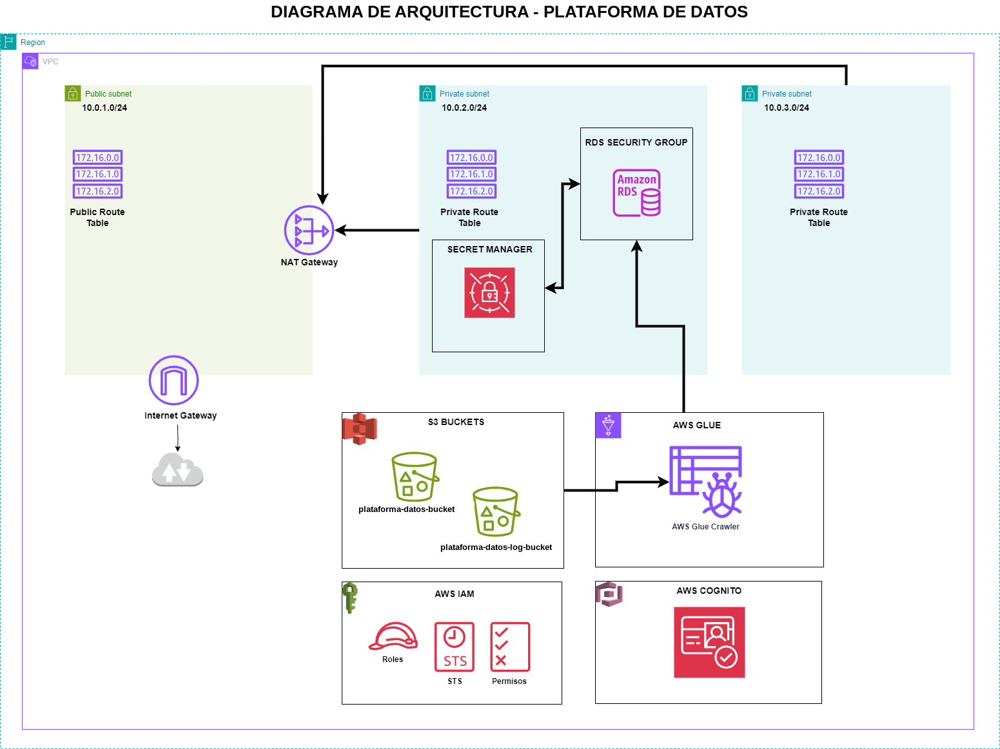

# Plataforma de datos en AWS con Terraform

Infraestructura como código para una plataforma de datos de demostración en AWS: red aislada, data lake en S3 con catálogo de Glue, base de datos relacional, autenticación de usuarios con Cognito y credenciales gestionadas en Secrets Manager. Todo se declara en Terraform y se valida en cada cambio con un workflow de GitHub Actions.

## Objetivo

Mostrar cómo se aprovisiona de forma reproducible el esqueleto de una plataforma de datos pequeña:

- Almacenar archivos CSV en un data lake con cifrado, versionado y registro de accesos.
- Catalogar esos archivos automáticamente con un crawler de Glue.
- Tener una base relacional en subredes privadas cuyas credenciales no viven en el código.
- Autenticar a los usuarios de una aplicación con Cognito.

## Arquitectura



El flujo es el siguiente:

1. Los archivos CSV (por ejemplo los de `datos-ejemplo/`) se cargan en el bucket del data lake.
2. El crawler de Glue lee el bucket, infiere el esquema y publica las tablas en el catálogo de Glue.
3. Glue usa un rol de servicio propio para acceder al bucket y a la base de datos.
4. La base de datos RDS vive en subredes privadas; solo recibe tráfico desde dentro de la VPC.
5. La contraseña de la base de datos se genera con Terraform y se guarda en Secrets Manager.
6. Los usuarios de la aplicación se registran e inician sesión en Cognito, que entrega credenciales temporales mediante un identity pool.

## Componentes

| Componente | Archivo | Qué crea |
|---|---|---|
| Red | `terraform/modulos/plataforma-datos/vpc.tf` | VPC `10.0.0.0/16`, una subred pública y dos privadas, Internet Gateway, NAT Gateway, tablas de rutas y grupo de seguridad de la base de datos |
| Data lake | `terraform/modulos/plataforma-datos/datalake.tf` | Bucket de datos y bucket de logs, bloqueo de acceso público, versionado, cifrado, ciclo de vida y política del bucket |
| Glue | `terraform/modulos/plataforma-datos/data_integrator.tf` | Base del catálogo, clasificador CSV, crawler y rol de servicio |
| Base de datos | `terraform/modulos/plataforma-datos/database.tf` | Instancia RDS MySQL `db.t3.micro` cifrada, con autenticación IAM y logs en CloudWatch |
| Secretos | `terraform/modulos/plataforma-datos/secret.tf` | Contraseña aleatoria y secreto en Secrets Manager con los datos de conexión |
| Autenticación | `terraform/modulos/plataforma-datos/cognito.tf` | User pool, cliente de aplicación, dominio, identity pool y roles para identidades autenticadas |

El directorio `terraform/` es la raíz que se despliega: instancia el módulo `plataforma-datos` para el entorno `dev` y fija las versiones de Terraform y del proveedor de AWS en `versions.tf`.

## Estructura del repositorio

```
.
├── .github/workflows/ci-terraform.yml   CI: fmt, validate, tflint y Checkov
├── datos-ejemplo/                       CSV de muestra para probar el crawler
├── docs/                                Diagrama y capturas de la consola
└── terraform/
    ├── main.tf                          Instancia el módulo para el entorno dev
    ├── providers.tf
    ├── variables.tf
    ├── versions.tf
    └── modulos/plataforma-datos/        Red, data lake, Glue, RDS, Cognito y secretos
```

## Requisitos

- Terraform 1.10 o superior.
- Una cuenta de AWS y credenciales con permisos para crear los recursos anteriores (variables de entorno o un perfil de AWS CLI).
- Opcional, para validar localmente: `tflint` y `checkov`.

## Despliegue

```bash
cd terraform
terraform init
terraform plan -out=plan.tfplan
terraform apply plan.tfplan
```

Después del despliegue:

1. Sube los archivos de `datos-ejemplo/` al bucket del data lake.
2. Ejecuta el crawler de Glue desde la consola o con `aws glue start-crawler`.
3. Consulta las tablas generadas en el catálogo de Glue.

La región por defecto es `us-west-1`; se cambia con la variable `aws_region`.

## Validación y CI

El workflow `ci-terraform.yml` corre en cada pull request y en cada push a `main` que toque `terraform/`:

- `terraform fmt -check -recursive`
- `terraform validate`
- `tflint`
- Checkov sobre `terraform/`

Las acciones están fijadas por SHA. Para correr las mismas comprobaciones en local:

```bash
terraform fmt -check -recursive terraform
tflint --chdir terraform --recursive
checkov -d terraform
```

### Hallazgos de Checkov omitidos

Los hallazgos que se resuelven sin cambiar la arquitectura están corregidos en el código. Los que exigirían rediseñar la plataforma o aumentar el costo de una demostración se omiten con `#checkov:skip` y un motivo, nunca con una omisión global:

| Regla | Recurso | Motivo |
|---|---|---|
| CKV_AWS_157 | `aws_db_instance.rds_instance` | Entorno de demostración de una sola zona; Multi-AZ duplica el costo de la instancia |
| CKV_AWS_118 | `aws_db_instance.rds_instance` | El monitoreo avanzado requiere un rol IAM adicional y tiene costo; se usa CloudWatch básico |
| CKV2_AWS_62 | `aws_s3_bucket.datalake`, `aws_s3_bucket.log_bucket` | Sin consumidores de eventos en la demostración; las notificaciones requieren SNS o SQS adicionales |
| CKV_AWS_144 | `aws_s3_bucket.datalake`, `aws_s3_bucket.log_bucket` | La replicación entre regiones duplica almacenamiento y costo en una demostración de una sola región |
| CKV_AWS_145 | `aws_s3_bucket.datalake`, `aws_s3_bucket.log_bucket` | Cifrado SSE-S3 en lugar de KMS propio; en el bucket de logs S3 solo admite SSE-S3 |
| CKV2_AWS_61 | `aws_s3_bucket.log_bucket` | La retención de logs se define al desplegar según el entorno |
| CKV_AWS_111, CKV_AWS_356 | `aws_iam_policy_document.rds_policy_document` | El crawler consulta instancias RDS creadas en el mismo despliegue; en un entorno real se acotan las acciones y el recurso |
| CKV_AWS_195 | `aws_glue_crawler.s3_crawler` | La configuración de seguridad de Glue exige una llave KMS adicional |
| CKV_AWS_149 | `aws_secretsmanager_secret.rds_secret` | Llave administrada por AWS en lugar de KMS propia, para no sumar costo |
| CKV2_AWS_57 | `aws_secretsmanager_secret.rds_secret` | La rotación automática requiere una función Lambda de rotación fuera del alcance |
| CKV2_AWS_12 | `aws_vpc.plataforma_datos_vpc` | El grupo de seguridad por defecto no se usa; se declara uno propio para la base de datos |
| CKV2_AWS_11 | `aws_vpc.plataforma_datos_vpc` | Los flow logs requieren grupo de logs y rol IAM con costo |
| CKV_AWS_130 | `aws_subnet.public_subnet` | La subred pública aloja la NAT Gateway, que necesita IP pública |
| CKV_AWS_382 | `aws_security_group.rds_sg` | La base de datos sale a internet solo a través de la NAT, para actualizaciones |

## Costos aproximados

Estimación mensual en `us-west-1` con el entorno encendido todo el mes, sin contar transferencia de datos ni uso intensivo:

| Recurso | Costo aproximado (USD/mes) |
|---|---|
| NAT Gateway | 33 a 40 |
| RDS MySQL `db.t3.micro` con 20 GB | 15 a 20 |
| Elastic IP de la NAT | 4 |
| S3, Glue crawler y Secrets Manager | menos de 5 con datos de ejemplo |
| Cognito | gratis dentro de la capa gratuita |

El NAT Gateway es el costo dominante. Para una demostración puntual conviene desplegar, probar y destruir el mismo día.

## Limpieza

La instancia RDS tiene protección contra borrado activada por defecto. Para destruir el entorno:

1. En `terraform/main.tf`, agrega `deletion_protection = false` dentro del bloque `module "data_platform_dev"`.
2. Ejecuta `terraform apply` para que el cambio se aplique a la instancia.
3. Vacía el bucket de datos si contiene versiones anteriores de los objetos.
4. Ejecuta `terraform destroy`.
